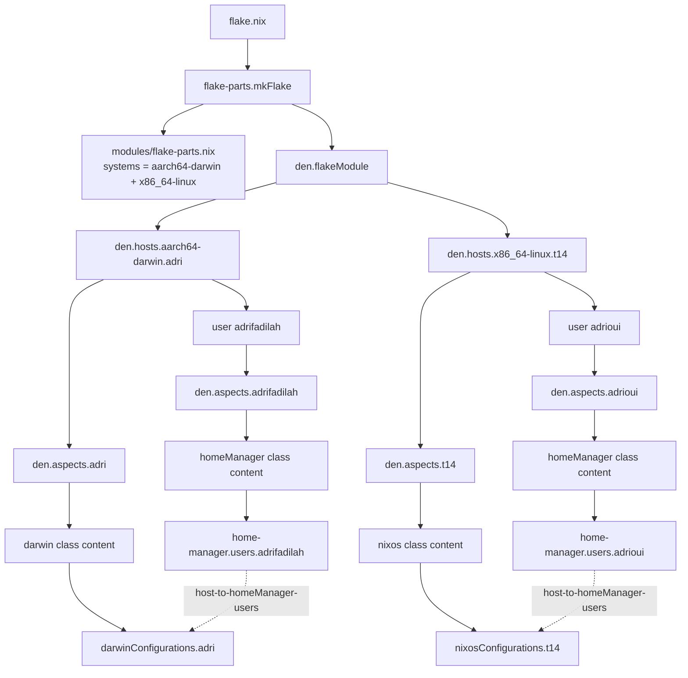
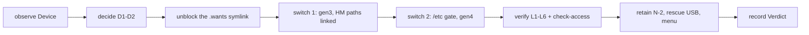

# Resolution and migration graphs

Status: **Gate 1 draft — no implementation writes yet**

The happy-path graphs contain only the success data flow. Failure handling,
retries, and secret plumbing are wrappers; they are listed separately in
sections 4–8. Every node maps to a file, aspect, command, or artifact in
section 9.

## 1. Den resolution graph



### ASCII call graph

```text
flake.nix
└─ flake-parts.mkFlake
   ├─ modules/flake-parts.nix
   │  └─ systems = [ "aarch64-darwin" "x86_64-linux" ]
   └─ den.flakeModule
      ├─ den.hosts.aarch64-darwin.adri
      │  ├─ den.aspects.adri                    # host aspect
      │  │  ├─ base.darwin                      # nix settings, system.primaryUser
      │  │  ├─ homebrew.darwin                  # casks/brews
      │  │  ├─ vpn.darwin                       # tailscale + launchd netbird
      │  │  ├─ audio.darwin                     # Pure Data stack
      │  │  ├─ max.darwin                       # Homebrew cask
      │  │  ├─ ai.darwin                        # amp-cli, llm-agents, herdr
      │  │  ├─ shell.darwin                     # alacritty, kitty
      │  │  ├─ editor.darwin                    # vim, neovim, helix
      │  │  ├─ dev.darwin                       # dev toolchain
      │  │  ├─ media.darwin                     # qbittorrent, ffmpeg, casks
      │  │  ├─ xcode.darwin                     # xcodebuildmcp
      │  │  └─ browser.darwin                   # helium
      │  └─ user adrifadilah
      │     ├─ den.aspects.adrifadilah          # user aspect
      │     │  ├─ base.homeManager              # home.stateVersion
      │     │  ├─ vpn.homeManager               # cloudflared
      │     │  ├─ ai.homeManager
      │     │  ├─ ampDeepseek.homeManager       # launchd + Keychain
      │     │  ├─ shell.homeManager             # zsh/starship + Keychain
      │     │  ├─ media.homeManager             # yt-dlp
      │     │  └─ max.homeManager               # nn_tilde
      │     └─ homeManager class
      │        └─ home-manager.users.adrifadilah
      └─ den.hosts.x86_64-linux.t14
         ├─ den.aspects.t14                     # host aspect
         │  ├─ base.nixos                       # nix settings, stateVersion
         │  ├─ nixosHardware.nixos              # T14 + Intel + UUIDs/initrd
         │  ├─ nixosDesktop.nixos               # Plasma, PipeWire, TLP, zram
         │  ├─ vpn.nixos                        # Tailscale only
         │  ├─ browser.nixos                    # Helium policy
         │  ├─ dev.nixos                        # rootless Podman, nix-ld
         │  └─ shell.homeManager                # zsh/starship
         └─ user adrioui
            ├─ den.aspects.adrioui              # user aspect
            │  ├─ base.homeManager              # home.stateVersion default
            │  ├─ ampDeepseekNixos.homeManager  # systemd + sops; proxy only
            │  ├─ shell.homeManager             # zsh/starship
            │  ├─ media.homeManager             # yt-dlp
            │  ├─ nixosUser.homeManager         # curated packages + Helium
            │  └─ adrioui.nixos                 # uid/gid 1000, group, zsh
            ├─ primary-user                     # wheel, networkmanager
            └─ homeManager class
               └─ home-manager.users.adrioui
```

`den.batteries.define-user`, `hostname`, `unfree`, and `flake-scope` are
activated from `den.default.includes`; `primary-user` is included by each
primary user aspect. The built-in `home-manager` battery supplies the
host→user forwarding policy; no custom topology policy is required.

The old Fedora proxy stack is not part of this graph. No old proxy unit,
script, tunnel, or provider key is copied to `t14`; the old stack stays
archived on the read-only backup. The repo-owned `amp-deepseek` proxy is
implemented natively on `t14` by `ampDeepseekNixos` as a systemd user unit with
new sops secrets. The Darwin `ampDeepseek` aspect remains on `adri` only.

## 2. Migration graph


### ASCII call graph

```text
read-only backup (/run/media/adrioui/backup)
  -> findmnt: ro,nosuid,nodev,relatime
  -> sha256sum of gate3/source.sha256 + gate3/destination.sha256
  -> sha256sum --check --quiet --strict (as root)
  -> metadata inventory (stat, getfacl, getfattr, hardlinks, symlinks)
  -> exclusion manifest approval
  -> rsync -aHASX --numeric-ids --filter=merge scripts/rsync-filter.rules \
       <include set> /home/adrioui.restore/
  -> staged verification:
       - manifest diff (source vs stage)
       - ownership/gid map
       - ACL/xattr/hardlink/symlink/timestamp checks
       - SQLite integrity (OpenCode, other DBs)
       - secret mode/owner checks (no content read)
       - broken symlink quarantine
  -> no rewrite: install /var/home/adrifadilah -> /home/adrioui (ADR-0009)
  -> home-manager switch (twice, backupFileExtension = "hm-backup")
  -> login as adrioui, shell/git/ssh/gpg/editor/service proof
  -> approved cutover:
       - stop user session and OpenCode
       - consistent SQLite backup of live DB
       - mv /home/adrioui /home/adrioui.pre-migration
       - mv /home/adrioui.restore /home/adrioui
       - activate new generation
       - reboot
  -> post-reboot proof
  -> rollback rehearsal (rename back, previous generation, reboot)
```

## 3. Node table

| # | Node | Input | Transformation | Output | Owner | Implementation | Evidence | Cardinality |
|---|---|---|---|---|---|---|---|---|
| 1 | Flake evaluation | `flake.nix`, `flake.lock` | `flake-parts.mkFlake`, `import-tree`, Den | flake outputs | repo | `flake.nix`, `modules/` | `nix flake show --all-systems` | one-shot per revision |
| 2 | Host resolution | `den.hosts` | host entity + aspect + users | host config | Den | `modules/den.nix` | `nix eval .#...config` | one-shot per host |
| 3 | User resolution | host users | user entity + aspect | user/home config | Den | `modules/den.nix`, `modules/host.nix` | `nix eval` of user options | one-shot per user |
| 4 | Class routing | aspect class keys | `darwin`/`nixos`/`homeManager` dispatch | OS/home module set | Den | aspects | `den.lib.capture`, eval | one-shot per class |
| 5 | Output assembly | resolved modules | `nixosSystem`/`darwinSystem`/HM | `nixosConfigurations`, `darwinConfigurations`, homes | Den | `den.flakeModule` | `nix flake show` | one-shot |
| 6 | Backup identity | mount + manifests | compare digests and line counts | verified manifest pair | operator | `sha256sum`, `wc -l` | `gate3/*.sha256` | one-shot |
| 7 | Root hash verification | backup tree + manifest | `sha256sum -c` as root | hash result | operator | runbook | `sha256sum` log | one-shot |
| 8 | Metadata inventory | backup tree | `stat`, ACL, xattr, hardlink, symlink map | metadata manifest | operator | runbook | metadata diff | one-shot |
| 9 | Exclusion policy | inventory + policy | reviewed rules | `scripts/rsync-filter.rules` | operator + approver | runbook | approval A3 | one-shot |
| 10 | Stage copy | backup + exclusions | `rsync -aHAX --numeric-ids` | `/home/adrioui.restore` | operator | runbook | rsync log, `df` | one-shot |
| 11 | Stage verification | stage tree + manifests | hash/metadata/DB/secret checks | verified stage | operator | runbook | check log | one-shot |
| 12 | Path rewrite | stage text files | replace old home paths | stage with new paths | operator | runbook | rewrite manifest | one-shot |
| 13 | Home activation | stage + flake | `home-manager switch` | home generation | operator | `modules/*.nix` | HM log, generation | repeated (idempotence) |
| 14 | Login proof | new home | TTY login + app checks | login evidence | operator | runbook | transcript, screenshots | one-shot |
| 15 | Cutover | approved stage + old home | rename homes, activate generation | live new home | operator + approver | runbook | approval A4/A5, transcript | one-shot |
| 16 | Reboot proof | live new home | reboot + login + service checks | accepted system | operator | runbook | journal, `systemctl` | one-shot |
| 17 | Rollback rehearsal | previous home/generation | rename back, switch generation | restored old state | operator | rollback runbook | generation list, login | one-shot |

## 4. Cardinality

| Class | Nodes | Rule |
|---|---|---|
| One-shot | flake evaluation, system build, hash verification, restore copy, cutover, rollback | never model as a daemon; no automatic retry on destructive steps |
| Repeated / streaming | CI checks, service health checks, journal/metrics, backups, secret rotation, GC, monitoring | idempotent; bounded; observable |
| Time-bounded | restore window, maintenance window, rollback window, caches, temporary build artifacts | acquire and release explicitly; no GC during migration |

## 5. Failure table

| Node | Failure | Strategy | Required evidence |
|---|---|---|---|
| Backup mount | `BackupNotReadOnly` | Die | `findmnt` options; remount and re-check |
| Manifest identity | `HashMismatch` | Die | digest and line-count diff |
| Root hash | `HashMismatch` | Die | `sha256sum -c` output; preserve |
| Manifest read | `ManifestUnreadable` | Retry once as root, then Die | permission/IO error |
| Metadata | `MetadataMismatch` | Die | `stat`/ACL/xattr diff |
| Ownership | `UnmappedOwnership` | Die until A2 | `getent group 1000`, `find -nogroup` |
| Space | `InsufficientSpace` | Die | `df -h`, `df -i` before copy |
| Package | `PackageUnavailable` | Escape | `meta.platforms`, build log; substitute/omit |
| Darwin | `DarwinRegression` | Die | unexpected drv path diff; revert |
| VM boot | `VMBootFailure` | Retry once with logs, then Die | serial console, `journalctl -b` |
| Login | `LoginFailure` | Die | TTY transcript, PAM/journal |
| Home activation | `HMActivationFailure` | Die | HM log, conflict list |
| Service | `ServiceFailure` | Retry bounded, then Die | `systemctl status`, journal |
| Secret | `SecretLeak` | Die | revoke/rotate, purge, incident record |
| Database | `DBCorruption` | Die | `PRAGMA integrity_check`, `.backup` verify |
| Cutover | `CutoverUnsafe` | Die | not root TTY/live USB; move to safe path |
| Rollback | `RollbackFailure` | Die | highest severity; keep both homes/generations |
| Lock | `FlakeLockDrift` | Die | `sha256sum flake.lock` |
| Download | `NetworkTimeout` | Retry bounded | download log; never for hash checks |

## 6. Dependencies (R)

| Dependency | Required by | Enforcement | Failure if absent |
|---|---|---|---|
| `den` at `ba9ee3a5…` | all Den evaluation | `flake.lock` | `FlakeLockDrift` / `EvalError` |
| `nixpkgs`, `home-manager`, `flake-parts`, `import-tree` | evaluation | `flake.lock` | `EvalError` |
| `sops-nix` (proposed) | secrets | pinned flake input at Gate 2 | `EvalError` / `SecretLeak` |
| `host`, `user`, `home`, `class`, `config`, `pkgs`, `lib`, `inputs` | aspects | Den context / `flake-scope` | `EvalError` |
| hardware facts: UUIDs, boot loader, swap, filesystems | NixOS host | `modules/nixos-hardware.nix` | `VMBootFailure` |
| root privilege | hash verification, restore ownership, cutover | root TTY / live USB | `PrivilegeUnavailable` |
| user privilege | home-manager activation | login session | `LoginFailure` |
| backup mount + manifests | migration | `findmnt`, `sha256sum` | `HashMismatch` |
| secret references + key custody | services | sops/age | `SecretLeak` / `ServiceFailure` |
| network/substituters | builds | flake inputs / cache | `NetworkTimeout` |
| target free space + inodes | restore | `df -h`, `df -i` | `InsufficientSpace` |
| maintenance window | cutover | approval A4 | `CutoverUnsafe` |

Dependencies must not be hidden in `builtins.getEnv`, ambient shell state,
unpinned channels, import side effects, or ad-hoc filesystem reads. No
`--impure`.

## 7. Boundaries

| Boundary | Untrusted until | Validation | One definition |
|---|---|---|---|
| Backup filesystem | mount options, label, UUID, SMART, read-only | `findmnt`, `blkid`, SMART evidence, read-only remount check | runbook |
| Old configuration | parsed and validated | text/config parse; no blind copy of `/etc` | migration runbook |
| Package metadata | `meta.platforms`, `meta.broken`, `meta.license`, unfree | `nix eval` before referencing | package table |
| External repo | exact commit + `flake.lock` | `git rev-parse`, `sha256sum flake.lock` | baseline |
| Secret files | mode, owner, consumer | `stat`, `getfacl`; never log content | secret inventory |
| Environment variables | validated and explicitly injected | sops template / systemd `EnvironmentFile` | secret runbook |
| Network responses | checksum/signature | fixed-output hashes, TLS | package table |
| Manifest lines | format, path safety, digest | reject absolute paths, `..`, newlines, malformed lines | runbook |

## 8. Wrappers, scope, and tests

### Wrappers

| Wrapper | Scope | Failure behavior | Evidence |
|---|---|---|---|
| Secrets (sops-nix + age) | system and home secrets | fail activation; never fall back to plaintext | mode/owner check, service start |
| Services (systemd) | user/system units | bounded restart; persistent failure stops | `systemctl status`, journal |
| Home-manager conflicts | `.zshrc`, `.bashrc`, `.profile`, `.gitconfig`, `.config/*`, user units | `backupFileExtension = "hm-backup"`; explicit conflict list | HM log, `*.hm-backup` |
| CI | every push | fail closed | CI matrix log |
| Firewall | NixOS | deny by default; explicit ports | `nft list ruleset`, `ss -ltnp` |
| Nix maintenance | both hosts | no GC during migration; keep N-1/N-2 | `systemctl list-timers`, generation list |
| Observability | both hosts | read-only checks | `systemctl --failed`, `journalctl -b -p err`, `ss -ltnp` |

### Resource scope

| Resource | Acquire | Release | On error/interrupt |
|---|---|---|---|
| Backup mount | read-only mount | unmount after verification | leave mounted read-only; do not write |
| Staging tree | create `/home/adrioui.restore` | remove only after cutover/rollback proof | keep for inspection; never delete evidence |
| Temp files | approved temp dir | trap removes | trap logs and preserves logs |
| Secrets | decrypt to runtime path | remove on stop | revoke/rotate if exposed |
| Services | start via systemd | stop cleanly | no orphan processes |
| Live OpenCode DB | stop process or SQLite `.backup` | verify DB/WAL/SHM | never overwrite live DB |
| Nix generations | keep N-1/N-2 | GC after window | no GC during migration |
| Cutover | root TTY/live USB | keep old home until proof | rename back |
| Rollback | previous home/generation | retain until acceptance | highest severity stop |

### Test ladder

| Step | Test | Command / method | Expected | Evidence |
|---|---|---|---|---|
| 1 | Static | `nix fmt --check`, `deadnix --fail`, `statix check`, `flake-checker`, `shellcheck`, `bash -n`, `zsh -n` | clean | CI log |
| 2 | Evaluation | `nix flake check --no-build --no-write-lock-file --no-update-lock-file --all-systems`; `nix eval` both hosts; `den.lib.capture` | both systems evaluate | eval log |
| 3 | Build | NixOS toplevel; `nixos-rebuild build-vm`; Darwin on macOS/remote builder | builds | drv/store paths |
| 4 | VM boot | boot VM, login `adrioui`, HM twice, decrypt test secrets, verify `amp-deepseek-proxy` health and no old proxy units | pass | serial log |
| 5 | VM health | `systemctl --failed`, `journalctl -b -p err`, `ss -ltnp`, `nft list ruleset`, `systemd-analyze security` | empty/expected | health log |
| 6 | Reboot | reboot VM; repeat login/secret/service checks | pass | second log |
| 7 | Rollback | switch generation, roll back, login, verify | pass | generation log |
| 8 | Migration fixture | ACL/xattr/hardlink/symlink/timestamp/ownership tree | metadata preserved | fixture log |
| 9 | Live test | `nixos-rebuild test` after VM gates | pass | transcript |
| 10 | Cutover rehearsal | spare disk/VM if possible | pass | rehearsal log |

Test R substitutions: test host, test user, test age key, fixture backup, fake
service endpoints. The graph does not change; only R changes.

## 9. Code-to-graph map

| Graph node | File / aspect / command |
|---|---|
| Flake evaluation | `flake.nix`, `modules/flake-parts.nix` |
| Host/user entities | `modules/den.nix` |
| Darwin host aspect | `modules/host.nix` (`den.aspects.adri`) |
| NixOS host aspect | `modules/t14.nix` (`den.aspects.t14`, `den.aspects.adrioui`) |
| Shared OS settings | `modules/base.nix` (`base.darwin`, `base.nixos`) |
| NixOS hardware | `modules/nixos-hardware.nix`, `hosts/t14/hardware-configuration.nix` |
| NixOS desktop | `modules/nixos-desktop.nix` |
| NixOS user packages | `modules/nixos-user.nix` |
| Shell | `modules/shell.nix` (`shell`, `shellDarwin`) |
| Editor | `modules/editor.nix` |
| Dev | `modules/dev.nix` |
| Media | `modules/media.nix` |
| VPN | `modules/vpn.nix` |
| AI | `modules/herdr.nix` |
| VM proof | `modules/vm-test.nix` (`checks.x86_64-linux.t14-vm`) |
| Browser / Xcode / audio / max / homebrew | existing Darwin-only modules |
| Per-system checks | `modules/per-system.nix` |
| Secrets | new `modules/secrets.nix` + `secrets/*.yaml` (Gate 2) |
| Services | no copied proxy units; NixOS modules in `modules/base.nix` / `modules/vpn.nix` |
| CI | `.github/workflows/ci.yml` (Gate 2) |
| Migration | `docs/design/migration.md` |
| Rollback | `docs/design/rollback.md` |
| Device acceptance | `scripts/device-verify.sh`; `/etc/duniawi/device-verify.sh` |
| Recorded revision | `modules/base.nix` assertion; `system.configurationRevision` |

If a node cannot be mapped to a file, aspect, command, or artifact, the graph
is wrong and must be redrawn before code is written.

## 10. Device-hardening graph

Status: **implemented; the live switch is pending.**

§1–§9 design the migration. This graph makes the running system match the
declared one: Home Manager activation, a recorded revision, and a retained
N-2 rollback. Every node is one-shot; the only repeated flow is the user's
session.



| # | Node | Input | Transform | Output | Implementation | Evidence |
|---|---|---|---|---|---|---|
| 1 | Observe | `Device` | read-only probes, unit audit | `Baseline` | `device-verify.sh`, P0 commands | `00-baseline.txt` |
| 2 | Decide | `Baseline` + owner | choose D1–D2 | `Plan` | signed decision row | decision record |
| 3 | Unblock | `Plan` | move the foreign `.wants` symlink | `Unblocked` | `mv` + `daemon-reload` | `readlink`, archive path |
| 4 | Switch 1 | `Revision` | build, switch, HM activation | gen3, 14 links | `nixos-rebuild switch` | HM log, `verify.tsv` |
| 5 | Switch 2 | gen3 + the `/etc` entry | build, switch | gen4 | `nixos-rebuild switch` | `system-4-link` |
| 6 | Verify | gen4, HM, Amp | six layers + `check-access` | `[LayerResult]` | `device-verify.sh` | `verify.tsv` |
| 7 | Retain | `System` | generations, USB, menu | `N-2`, `Rescue` | `nix-env`, `bootctl` | boot transcript |
| 8 | Record | results | update dossier and docs | `Verdict` | P5 | evidence dir |

The boot transcript in node 7 is not a free-form note. It is
`/var/lib/duniawi/boots/<boot_id>/boot.txt`, written by a root oneshot from
`/proc/sys/kernel/random/boot_id`, `/proc/cmdline`, `bootctl status` and the
generation revision. The N-1 menu transcript lives in the root evidence tree
and is `Attested` only when the journal has the same `_BOOT_ID` and its kernel
command line carries the N-1 `init=`. The N-2 record is the journal's
`Kernel command line:` line for that generation. Root ownership and the
journal binding make the record stronger than a file the operator typed; they
are not a cryptographic quote, and root on the target can still forge it.

### Device failures

| Node | Failure | Strategy | Evidence required |
|---|---|---|---|
| Unblock | `ForeignPathCollision` | Escape (known path) | the moved symlink path |
| Unblock | `DirtySource` | Die | `git status --porcelain` empty |
| Switch 1 | `EvalError` | Die | eval stderr |
| Switch 1 | `NetworkTimeout` | Retry 3× (5/15/45 s) | download log |
| Switch 1 | `HMActivationFailure` | Die; fix the collision, rerun once | `is-failed`, journal |
| Switch 2 | `StaleSource` | Die | built revision = durable HEAD |
| Verify | `ModelAccessFailure` | Retry once, then `Fail`; no OS rollback | `check-access` JSON/stderr |
| Verify | `LayerFail` | Die; roll back the phase | `verify.tsv` row |
| Retain | `GenerationShortfall` | Die | fewer than 3 generations |
| Retain | `RescueMediaAbsent` | Die for L6 | booted USB transcript |
